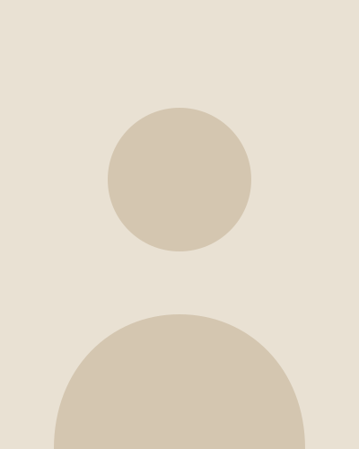

Homepagina

[rij verhouding=2:1]
[sectie]
[label Orthomoleculaire therapie]
# Precies genoeg, ==voor jou==.
Orthomoleculaire therapie kijkt naar wat een lichaam nodig heeft: voeding, vitaminen, mineralen, beweging en ontspanning. Niet te veel, niet te weinig, balans. 

In mijn praktijk kijken we samen naar jouw behoefte, te beginnen bij voeding en leefstijl. Ik bied advies en handvatten — het werk doe je zelf, in jouw tempo.
- **Niet te veel, niet te weinig**

[Maak direct een afspraak](#agenda){.knop}
[Liever eerst kennismaken](#contact){.knop}

[sectie patroon=images/molecuulnet-blad.svg schaal=1.5 uitlijning=onder beweging=drijven tempo=60]
> **lagom** *(Zweeds)*: precies genoeg; niet te veel, niet te weinig.

Volgens een volksverhaal komt het van *laget om*: de kom ging de kring rond en iedereen nam net genoeg, zodat er voor iedereen was.

[rij]
[sectie thema=groen patroon=images/lagom.svg]
[label Aanbod]
## Waar ik je mee help
Van een eerste gesprek tot een plan dat in je dagelijks leven past. In mijn praktijk kijken we samen naar jouw behoefte, te beginnen bij voeding en leefstijl. Ik bied advies en handvatten, het werk doe je zelf, in jouw tempo.

## Waar ik je mee help
Heb je klachten waar je maar niet vanaf komt, of wil je juist gezond en fit blijven? Samen zoeken we uit wat jouw lichaam nodig heeft.

[kaart]
### Preventie
- Gezondheids-APK
- Vitaal en fit ouder worden
- Afvallen of aankomen, zonder jojo-effect
- Schommelende bloedsuiker of steeds trek in zoet
- Insulineresistentie
- Spier- en gewrichtsklachten

[kaart]
### Buik, darm en huid
- Opgeblazen gevoel en winderigheid
- (Wisselende) buikpijn
- Diarree of verstopping
- PDS, IBD, MCAS
- Histamineklachten en voedingsintoleranties
- Huidklachten en acne

[kaart]
### Immuunsysteem
- Post-covid of post-virale klachten
- Snel moe of vaak moe
- Snel of vaak ziek of verkouden
- Lang klachten houden of slecht herstellen

[rij verhouding=1:2]
[sectie]
[label Werkwijze]
## Zo werk ik
[kaart]
### Preventie
- APK
- Vitaal ouder worden
- Vitaal blijven
- Gewichtsbeheersing: afvallen/aankomen
- Spier- en gewrichtsklachten
- Insuline resistentie
  
[kaart]
### Buik, darm, huid...
- Opgeblazen gevoel, gasvorming
- (wisselende) buikpijn
- Diarree, obstipatie
- PDS, IBD, MCAS, histamineklachten, voedingsintoleranties
- Huidklachten, acne
  
[kaart]
### Immuunsysteem
- Post-covid of post-viraal klachten
- Vaak of snel moe
- Snel of vaak ziek/verkouden
- Lang klachten houden, niet goed herstellen 

[rij verhouding=1:2]
[sectie]
[label Werkwijze]
## Zo werk ik

We beginnen met een korte kennismaking. Daarin kijken we samen of mijn aanpak bij je past.

Elk traject start met luisteren: de intake. Ik neem de tijd om je klachten, je voeding en je leefstijl goed in beeld te brengen. Op basis daarvan maken we samen een plan dat past bij jouw dagelijks leven.
[Plan een kennismaking](#contact){.knop}

[sectie]
[kaart]
###  Advies op maat
In de vervolgconsulten kijken we wat werkt en stellen we het plan bij waar nodig. Soms geeft aanvullend onderzoek meer inzicht, bijvoorbeeld een bloed- of ontlastingsonderzoek. Dat bespreken we altijd eerst samen. Ik werk hiervoor met verschillende laboratoria, zoals NL-Lab in Leeuwarden en LHM Diagnostiek. Je krijgt een concreet plan voor voeding, suppletie en leefstijl.

[kaart]
### Nader te bepalen
Je krijgt een concreet plan voor voeding, suppletie en leefstijl.

[kaart]
### Tarieven en vergoeding
- Intake 120 minuten € 125,-
- Consult 60 minuten € 90,-
- Consult 30 minuten € 45,-
- Workshops op aanvraag.

Verschillende zorgverzekeraars bieden een (gedeeltelijke) vergoeding. Lees dit na in jouw polisvoorwaarden.

[kaart]
### Begeleiding
nader te bepalen

[rij]
[sectie thema=geel patroon=images/honingraat.svg schaal=1.5]
[label Agenda]
## Plan een afspraak

[sectie thema=geel patroon=images/honingraat.svg schaal=1.5]
[html]

[/html]

[rij verhouding=1:2]
[sectie]

[sectie]
[label Over mij]
## Aandacht voor het geheel
Ik ben Ellen Spijkers en woon in Hilvarenbeek. Hier woon ik samen met mijn man, onze twee kinderen en hond. In mijn vrije tijd ben ik graag buiten, bijvoorbeeld wandelend met de hond.

Zelf kwam ik met orthomoleculaire therapie in aanraking vanuit post-COVID klachten. Die ervaring sluit aan bij hoe ik werk: niet alleen klachten verzachten, maar via onderzoek zoeken naar de onderliggende oorzaak en het systeem dat daarbij hoort.

### Opleiding en bijscholing
Naast de afgeronde 4-jarige Beroepsopleiding tot Orthomoleculair therapeut bij Ortho Linea (Nijmegen), volg ik continue bijscholingen. Dit zijn bijscholingen variërend van congressen en dagopleidingen. 
- Voedingsgeneeskunde beurs 2024, 2025 en 2026
- Academische darmopleiding 4 + 5 dagen, NL-Lab Leeuwwarden
- Bijscholingen: Post-covid, Post viraal syndroom
- Kinderbuikjes, 

[rij]
[sectie thema=rood patroon=images/stippen.svg]
[label Contact]
## Contactgegevens en openingstijden

**Openingstijden**\
Maandag 19.00 - 21.00\
Woensdag 9.00 - 12.00\
Vrijdag 9.00 - 16.00

**Adres**\
Centrum de Mens (Ingang via Gildelaan)\
Tilburgseweg 2B\
5081 XJ Hilvarenbeek\
Bushalte Doelenstraat op 100 meter

**Andere locatie en of ander tijdstip?\
Neem dan contact op per mail of telefoon**\
Lange Akker 29\
5081 MR Hilvarenbeek

[sectie thema=rood patroon=images/stippen.svg]
[kaart]
### E-mail
[a.b@c.com](mailto:a.b@c.com)

[kaart]
### Telefoon
06 – 30780219
